<div align="center">

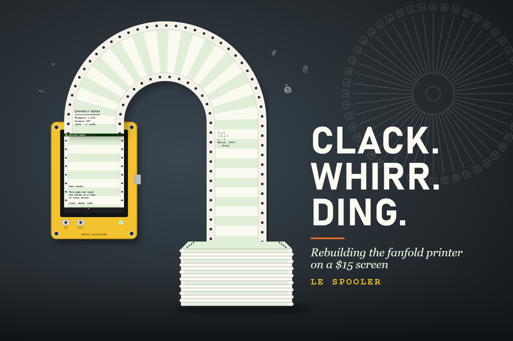

# LE SPOOLER

### The fanfold daisy wheel printer that never was, rebuilt on a $15 screen.

[](https://github.com/waywardtech/CYD-Printer-Spooler-LeFrite/actions/workflows/ci.yml)


[](LICENSE)

**[The story](#-the-story)** · **[Install](#-install)** · **[Print to it](#%EF%B8%8F-use-it)** · **[Add it as a printer](#%EF%B8%8F-add-it-as-a-printer-desktop-apps--bonjour)** · **[Flash the CYD](#-flash-the-cheap-yellow-display)** · **[How it works](#-how-it-works)**

</div>

---

> *The first word it ever typed was* **HELLO**. *It arrived one character at a time, about thirty every second, each with a tiny percussive click. Then the carriage whirred home, the platen ratcheted the paper up a line, and a bell rang.*

**LE SPOOLER** turns a Linux box and an ESP32 **"Cheap Yellow Display"** into a pretend fanfold printer that behaves like a real one. It shows up in the Print dialog of Windows, Mac and Linux apps, is discoverable over Bonjour, and types every page out **one character at a time**. The paper is green-and-cream greenbar with sprocket holes and perforations, and you hear the clack of the hammer, the whirr of the carriage return and the *ding* of the bell.

Accents are made the old way, by **overstrike**: `e`, backspace, `'` becomes **é**. Photos come out as **ASCII art**. If you ask, it will even jam, run out of paper and wear out its ribbon.

It's a fun weekend build, a great way to explore **classic technology with kids**, and a surprisingly useful rig for **testing printing on your home network**.

## 📰 The story

For most of computing's first three decades, **the screen was paper**. The Teletype Model 33 (1963) typed ten upper-case characters a second onto a roll. In 1970, Andrew Gabor at Diablo Data Systems patented the **daisy wheel**: every character on the tip of a plastic petal, spun into place and struck through a ribbon. By 1980 Diablo's 630 was what "letter quality" meant, at 30 characters a second. All of it ran on **fanfold paper**, 14⅞ × 11 inches, with half-inch greenbar stripes and sprocket holes down both edges: an icon of a bygone age.

It was romantic, and it was maddening. A full page took about three minutes. Printers were loud enough that offices bought foam hoods to muffle them. Ribbons faded to grey, film ribbons were single-use, and every job shed tractor strips and blank tear-off paper into the bin. LE SPOOLER recreates the romance and lets you dial in the misery as a game.

<table>
<tr>
<td width="50%">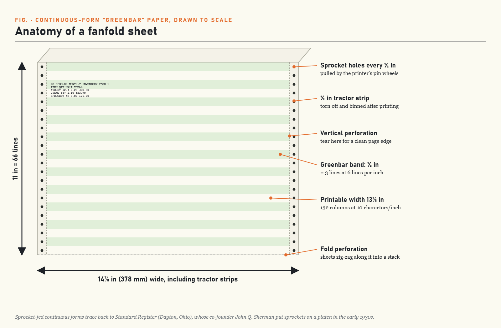</td>
<td width="50%">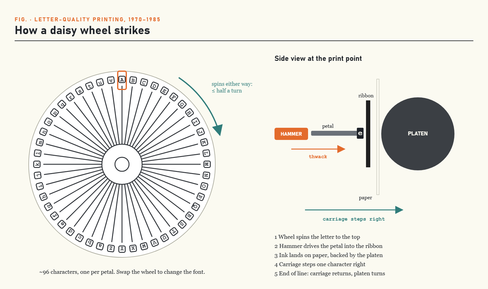</td>
</tr>
<tr>
<td><sub><b>Anatomy of a fanfold sheet</b>: drawn to scale, and redrawn pixel-for-pixel on the CYD.</sub></td>
<td><sub><b>How a daisy wheel strikes</b>: change the wheel, change the font.</sub></td>
</tr>
<tr>
<td>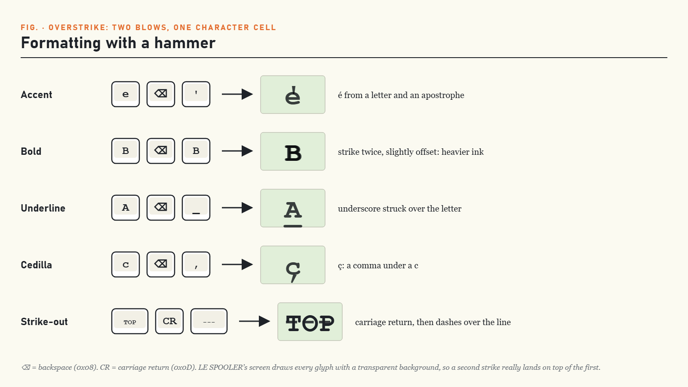</td>
<td>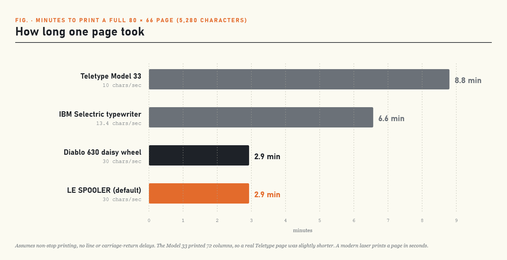</td>
</tr>
<tr>
<td><sub><b>Formatting with a hammer</b>: two blows, one cell. LE SPOOLER honours every trick.</sub></td>
<td><sub><b>How long one page took.</b> Go to lunch.</sub></td>
</tr>
</table>

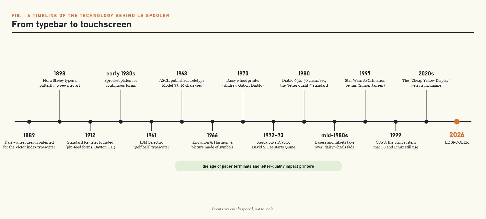

## ✨ What it does

| | |
|---|---|
| 🖨️ **A real network printer** | A CUPS backend makes **LE SPOOLER** appear in every app's Print dialog, and Bonjour lets other computers on the LAN discover it. Windows gets a one-script installer. |
| ⌨️ **Types like the real thing** | One character at a time at 30 cps, with backspace/overstrike, carriage return, line feed, form feed, bell and tab all behaving as instructions to a machine with moving parts. |
| é **Overstrike accents & tricks** | `é à ô ñ ç ü`, **bold** by double strike, underline with `_`, strike-through with `-`, `Ø ¢ ≠ £`. |
| 🖋️ **Looks like real type** | Typewriter face, uneven hammer pressure, translucent ribbon ink, tiny dropouts where the type didn't bite, and true overtype. |
| 🖼️ **Photos → ASCII art** | Print a photo from any app and it comes out as dithered ASCII art sized for the paper. Scanned pages are read back with OCR. |
| 🌐 **Web UI** | Type a document, watch the queue, and manage jobs: view, hold, release, reprint, delete. It shows whether a printer is collecting jobs, and a **virtual printer** switch lets the browser print before the CYD exists. |
| 🎞️ **ASCII animations** | Ten classics: spinner, bouncing ball, waving robot, rocket, train, fish tank, matrix rain, starfield, radar and printer self-test. Pause, step frame by frame, and print any frame. |
| 🎲 **Printer chaos** *(optional)* | Paper jams, paper out, misstrikes, skew and a fading ribbon. Off by default. Charming for about ten minutes. |
| 🔊 **The soundscape** | Hammer strikes, carriage whirr, ratcheting line feeds and a 2 kHz bell, all synthesised live on the CYD's speaker pin. |
| 📟 **CYD firmware** | Draws the paper, types jobs, saves them to microSD, and takes jobs over Wi-Fi **or** USB serial. Compiled in CI. |

## 🧭 How it works

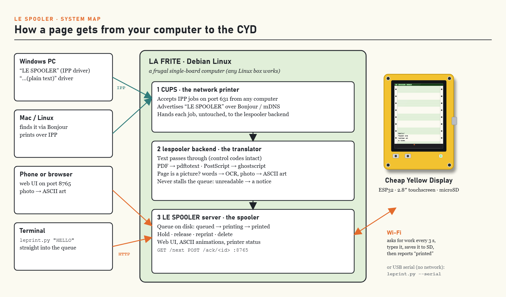

A **spooler** takes print jobs instantly, parks them in a queue, and feeds them to the printer at the printer's pace. LE SPOOLER makes that machinery visible:

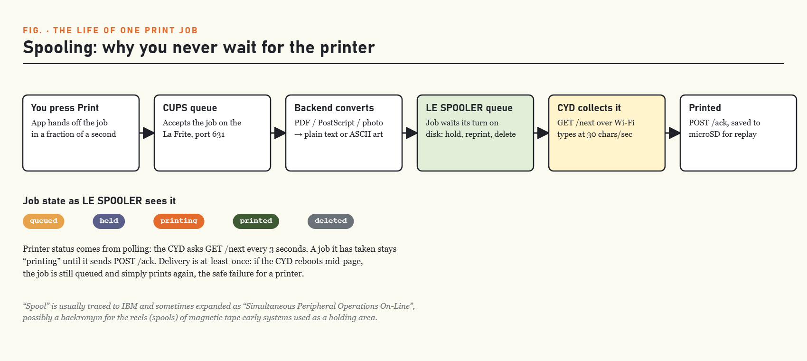

When a page arrives as a *picture* rather than text, which is what driverless printing from Windows, Macs and phones often sends, the backend renders it and decides for itself. If it finds words, it reads them with OCR; if it finds a photo, it draws ASCII art:

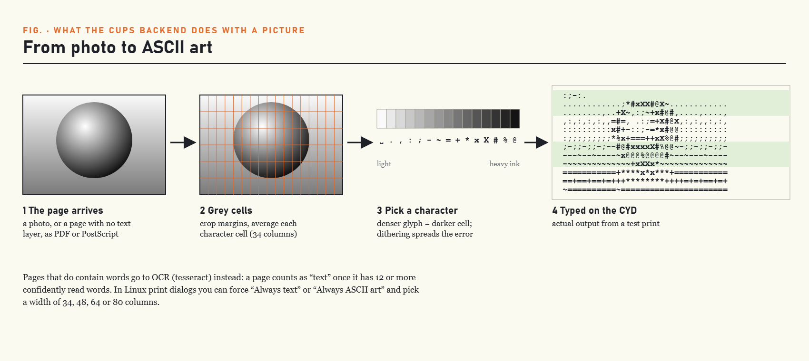

<details>
<summary><b>Meet the Cheap Yellow Display</b></summary>

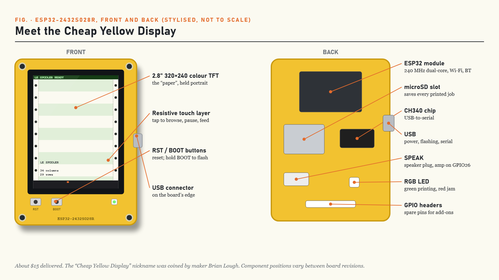

The **ESP32-2432S028R**, nicknamed the *Cheap Yellow Display* by maker Brian Lough, packs a dual-core Wi-Fi/Bluetooth ESP32, a 2.8″ 320×240 touchscreen, microSD, an RGB LED and a speaker amplifier onto one yellow board for about $15.

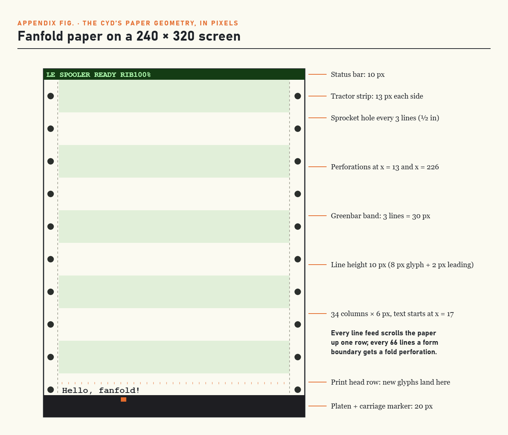
</details>

## 📦 Prerequisites

**Spooler (required)**
- Any Linux machine with **Python 3.9+**. Developed on a Libre Computer *La Frite* running Armbian (Debian 13), and works the same on a Raspberry Pi or a laptop. macOS works too.
- That's it: no pip, no venv, no frameworks.

**Display (optional, for the real thing)**
- A **Cheap Yellow Display**, *ESP32-2432S028R* (about $15). ILI9341 and ST7789 variants are both supported.
- A microSD card (to save printed documents) and a small **8 Ω speaker** on the SPEAK header (for the clack and ding). Both are optional.
- [`arduino-cli`](https://arduino.github.io/arduino-cli/) on any computer to build and flash the firmware.

## 🚀 Install

```bash
git clone https://github.com/waywardtech/CYD-Printer-Spooler-LeFrite.git ~/le-spooler
cd ~/le-spooler
./install.sh                 # checks Python, makes spool folders, runs the self-test
./install.sh --service       # optional: keep it running as a user service
```

The installer never uses `sudo` and never changes system settings.

## 🖨️ Use it

**Start the spooler** (skip this if you installed the service)

```bash
python3 server/le_spooler_server.py          # listens on 0.0.0.0:8765
```

**Print something**

```bash
python3 cli/leprint.py --title "Hello" "HELLO WORLD"
echo "Printed from a pipe" | python3 cli/leprint.py --title "Pipe"
python3 cli/leprint.py --file ~/letter.txt
python3 cli/leprint.py -e "Accents the old way: cafe\b' garc\b,on man\b~ana\a"
curl -X POST -H 'Content-Type: text/plain' --data 'HELLO' http://localhost:8765/print
```

**Watch it type** in a browser at **`http://<your-box>:8765/`**, or in a terminal:

```bash
python3 server/le_spooler_preview.py                     # next job in the queue
python3 server/le_spooler_preview.py --demo              # overstrike / CR / bell showcase
python3 server/le_spooler_preview.py --speed teletype --chaos low --ribbon 40
python3 server/le_spooler_preview.py --anim fish_tank --loops 0     # q to stop
```

**Animation controls.** These work in the terminal player, in the web UI (click the screen first), and on the CYD by touch:

| Terminal / web | CYD touch | Action |
|---|---|---|
| <kbd>space</kbd> | tap while playing / middle | pause · resume |
| <kbd>←</kbd> <kbd>→</kbd> | left / right third | step one frame back / forward |
| <kbd>p</kbd> (web: <kbd>P</kbd> or 🖨 button) | top-right **PRINT** | print the current frame onto the paper |
| <kbd>q</kbd> | top-left **EXIT** | back to the paper |

```bash
python3 server/le_spooler_preview.py --anim rocket_launch --frame 7          # show frame 7
python3 server/le_spooler_preview.py --anim rocket_launch --print-frame 7    # print it
```

<details>
<summary><b>Preview options and sample output</b></summary>

| Flag | Meaning |
|---|---|
| `--speed teletype\|daisywheel\|fast\|instant\|<cps>` | typing speed (default daisywheel, 30 cps) |
| `--chaos off\|low\|medium\|high` | random printer events (default **off**) |
| `--ribbon 0-100` | starting ink; faint text below ~35% |
| `--style greenbar\|bluebar\|plain\|thermal` | paper |
| `--width N` · `--page-lines N` | columns · lines per form (66 = 11″ at 6 LPI) |
| `--no-color` · `--ascii` · `--lf-only` | plain output · ASCII glyphs · strict line feeds |

```
╌ ╌ ╌ ╌ ╌ ╌ ╌ ╌ ╌ ╌ ╌ ╌ ╌ ╌ ╌ ╌ ╌  LE SPOOLER ╌ ╌ ╌ ╌ ╌ ╌ ╌ ╌ ╌ ╌ ╌ ╌ ╌ ╌ ╌ ╌ ╌
    ▒┊LE SPOOLER SELF-DEMO                                                  ┊▒
  ● ▒┊====================                                                  ┊▒ ●
    ▒┊Accents by overstrike: café ; voilà ; hôtel ; mañana ; garçon ; über  ┊▒
     ┊Bold by double strike: BOLD      Underline: UNDER                     ┊
  ●  ┊Typewriter tricks: Ø  ¢  ≠  £                                         ┊  ●
    ▒┊Bell coming up...                                                     ┊▒      DING!
```
</details>

## 🖥️ Add it as a printer (desktop apps + Bonjour)

LE SPOOLER ships a CUPS backend (`contrib/cups/lespooler`) and a small PPD. Once they're installed, **"LE_SPOOLER"** shows up in the Print dialog of every desktop app on the machine. With `--share`, it's also advertised over Bonjour (mDNS/DNS-SD), so other computers on the LAN discover it on their own.

```bash
sudo contrib/cups/install-cups-printer.sh            # this machine only
sudo contrib/cups/install-cups-printer.sh --share    # + discoverable on the LAN
contrib/cups/update-backend.sh                       # later, after git pull (no sudo)
echo "HELLO FROM CUPS" | lp -d LE_SPOOLER            # test
lp -d LE_SPOOLER ~/Documents/letter.pdf
```

Apps send PDF, PostScript or text. CUPS passes the file unfiltered to the `lespooler` backend, which converts it to plain text (`pdftotext -layout`, or ghostscript for PostScript), turns page breaks into form feeds, and posts the result to the spooler. If the spooler is down, CUPS holds the job and retries. A page the backend can't read prints a one-line notice instead, so **the queue never stalls**.

| Client | How to add it |
|---|---|
| Linux (GNOME/KDE) | Shows up automatically (driverless), or add it in Settings › Printers |
| macOS | System Settings › Printers & Scanners › **+**, pick "LE SPOOLER fanfold printer". If asked for a driver, choose **Generic PostScript Printer**. |
| Windows | Run `contrib\windows\install-windows-printer.ps1 -Server <your-box>` as administrator. It adds **LE SPOOLER** (IPP: Word, browsers, PDFs, photos) and **LE SPOOLER (plain text)** (Notepad, console output). `contrib\windows\print-test-pages.ps1` prints every case and checks each one reaches the printer. |

You can choose how picture pages print, *Auto / Always text / Always ASCII art*, and the art width (34 = the CYD's paper, up to 80) in a Linux print dialog, or with `lp -o LeSpoolerMode=Picture -o AsciiWidth=64`.

What `--share` changes on your system: it installs `avahi-daemon` if it's missing and runs `cupsctl --share-printers`, so CUPS listens on port 631 on your LAN. Undo it with `sudo cupsctl --no-share-printers` and `sudo contrib/cups/install-cups-printer.sh --uninstall`.

## 📟 Flash the Cheap Yellow Display

```bash
# one-time: arduino-cli + ESP32 core 2.0.17 + libraries (see firmware/README.md)
cp firmware/CYD_LE_SPOOLER_Arduino/config.example.h firmware/CYD_LE_SPOOLER_Arduino/spooler_config.h
nano firmware/CYD_LE_SPOOLER_Arduino/spooler_config.h      # Wi-Fi + spooler URL
FQBN=esp32:esp32:esp32:UploadSpeed=115200 UPLOAD_PORT=/dev/ttyUSB0 firmware/build.sh
```

Back up the board's original firmware first: `esptool.py --port /dev/ttyUSB0 --baud 115200 read_flash 0 0x400000 backup.bin`. Once it's flashed, the CYD asks the spooler for work every 3 seconds. You can also skip the network entirely:

```bash
python3 cli/leprint.py --serial /dev/ttyUSB0 "HELLO OVER USB"
```

> ⚠️ The pin map is the commonly published one for the ESP32-2432S028R. CYD clones vary, so check [`notes/hardware-notes.md`](notes/hardware-notes.md) before flashing. Use **115200 baud**: faster speeds corrupted data over this board's USB-serial chip in testing.

## 👪 Build it with kids

- **It shows its work.** Letters arrive one at a time, so "a computer sends characters" becomes something you can see and hear.
- **Hands-on history.** Type `e`, backspace, `'` and watch an é appear from two strikes. Then explain what a carriage was.
- **Make art.** Turn a photo into ASCII art and print it, or write an animation: an `.anim` file is just frames of text separated by `---`.
- **Break it on purpose.** Turn on chaos and cause paper jams with no paper wasted.

## 🧪 A home-network printer test rig

LE SPOOLER speaks the same protocols as a modern network printer (**IPP** through CUPS, **Bonjour** discovery), so you can see what your devices actually send when you press Print. Compare drivers, watch a stuck job hold up a queue, and test discovery on every computer in the house without wasting paper or toner.

## 🐱 Scratch / TurboWarp

The API sends open CORS headers. From **TurboWarp Desktop** (or any page served over plain `http://`), `POST` text to `http://<your-box>:8765/print` and it prints. The public `https://turbowarp.org` site can't call a plain-`http` LAN address, because browsers block mixed content, so use TurboWarp Desktop.

## 🔌 "Can it be a real USB printer?"

Not the ordinary CYD. Its original ESP32 has **no native USB**. The USB port goes through a CH340 serial chip, so a computer only ever sees a serial port. LE SPOOLER therefore uses **Wi-Fi and USB serial**. A plug-and-play **USB Printer Class** device needs a board with native USB, such as an **ESP32-S3**, which is the [v2 plan](docs/roadmap.md). Details: [`notes/cyd-usb-printer-reality-check.md`](notes/cyd-usb-printer-reality-check.md).

## 🛠️ Troubleshooting

<details>
<summary><b>The CYD shows in <code>lsusb</code> (1a86:7523) but there's no <code>/dev/ttyUSB0</code></b></summary>

On Debian-based systems the **brltty** braille-display service often claims CH340 serial chips the moment they're plugged in. If you don't use a braille display:

```bash
sudo systemctl stop brltty-udev.service brltty.service
sudo systemctl mask brltty-udev.service brltty.service
# then unplug and replug the CYD
```
</details>

<details>
<summary><b>The Linux box reboots when I unplug the CYD</b></summary>

In testing, unplugging the CYD from a small board's USB port rebooted the board, most likely from a dip in USB power. Power the CYD from its own supply or a powered hub.
</details>

<details>
<summary><b>Permission denied on /dev/ttyUSB0</b></summary>

`sudo usermod -aG dialout $USER`, then log out and back in.
</details>

<details>
<summary><b>Address already in use (port 8765)</b></summary>

Another spooler is already running: `ss -ltnp | grep 8765`. Stop it, or start this one with `--port 8766`.
</details>

<details>
<summary><b>Windows prints arrive jumbled or indented</b></summary>

Use **LE SPOOLER** (the IPP printer) for Word, browsers and anything with fonts. The **(plain text)** printer is for Notepad and console output. The backend strips the driver's margins automatically.
</details>

## 🗂️ Repository layout

```
server/le_spooler_server.py    HTTP spooler + web UI (server/web/index.html)
server/le_spooler_preview.py   terminal preview: paper, typing, overstrike, chaos, animations
cli/leprint.py                 send a job over HTTP or USB serial
assets/animations/*.anim       10 ASCII animations (tools/gen_animations.py rebuilds them)
firmware/                      CYD Arduino sketch + build.sh
contrib/cups/                  CUPS backend, PPD, printer installer (desktop + Bonjour)
contrib/windows/               Windows printer installer + end-to-end test pages
docs/protocol.md               job envelope, control codes, HTTP API, .anim format, serial
docs/roadmap.md                what's next
docs/images/                   the diagrams on this page
notes/                         hardware notes, USB-printer reality check
tests/                         end-to-end tests (python3 -m unittest discover -s tests)
install.sh · contrib/          installer, systemd user unit
```

## 🧑‍💻 Develop

```bash
python3 -m unittest discover -s tests -v       # server, CLI, preview and backend tests
python3 tools/gen_animations.py --force        # regenerate the animations
firmware/build.sh                              # compile the firmware
```

CI runs the tests on Python 3.11–3.13 and compiles the firmware for both CYD panel types.

## 📜 License & credits

[MIT](LICENSE) © 2026 Daniel Teixeira-Gomes. All code, ASCII art and illustrations in this repository are original. The firmware *uses*, but does not include, [TFT_eSPI](https://github.com/Bodmer/TFT_eSPI) (FreeBSD-style), [ArduinoJson](https://arduinojson.org) (MIT), [XPT2046_Touchscreen](https://github.com/PaulStoffregen/XPT2046_Touchscreen) (MIT-style) and the [ESP32 Arduino core](https://github.com/espressif/arduino-esp32) (LGPL-2.1), all compatible with distributing this project under MIT.

Thanks to Brian Lough and the [Cheap Yellow Display community](https://github.com/witnessmenow/ESP32-Cheap-Yellow-Display) for making a $15 board feel like a platform.
